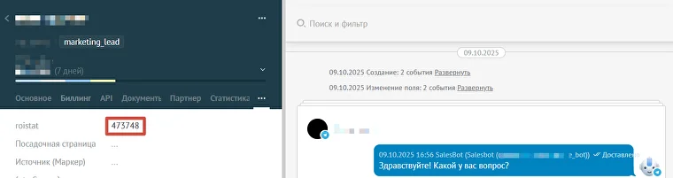

---
title: "Как передать UTM-метки из Telegram в Salesbot amoCRM с помощью скрипта"
summary: "Разбираю, как передать UTM-метки из Telegram-бота в amoCRM через Salesbot и не терять источники лидов"
date: "2026-10-22"
category: "Инструкции"
tags: []
cover: {"src":"./salesbot-utm-amocrm-cover.png","alt":"Светящаяся UTM-метка в сканере связывает сообщения бота с карточками контактов CRM"}
---

Если вы используете amoCRM и Telegram-бота, созданного на базе Salesbot{{Именно Salesbot от amoCRM: https://www.amocrm.ru/developers/content/digital_pipeline/salesbot}}, то, возможно, задавались вопросом: а как понять, из какого источника пришёл лид в бота? По умолчанию Telegram-бот на базе Salesbot не записывает в amoCRM UTM-метки или другие параметры аналитики. Из-за этого источники лидов теряются, и связать заявку с рекламной кампанией становится сложно.

Я нашёл способ решить эту задачу.

Для этого использую встроенный обработчик `meta` в Salesbot и небольшой скрипт на сайте. При запуске бота данные записываются в карточку сделки, при этом работа самого бота остаётся неизменной.

## Принцип работы

1. На моём сайте установлен скрипт, который получает значение `roistat_visit`{{Идентификатор визита в системе сквозной аналитики Roistat}} и автоматически добавляет его ко всем ссылкам на Telegram-бота через параметр `start`. Например, ссылка `https://t.me/your_bot` превращается в `https://t.me/your_bot?start=111111`, где `111111` — идентификатор визита в Roistat.
2. Когда пользователь переходит по ссылке и запускает бота, обработчик `meta` считывает переданное значение и записывает его в указанное поле сделки в amoCRM.
3. После этого бот функционирует в обычном режиме, а вы получаете недостающие данные для аналитики. При этом пользователь не заметит никаких изменений в работе бота.


*Пример передачи параметра roistat_visit в amoCRM при переходе с сайта в Telegram-бот.*

## Как настроить обработчик в Salesbot

В конструкторе Salesbot добавляем блок «Свой обработчик (код)» и вставляем следующий JSON:

```json
{
  "params": {
    "values": [
      "lead.custom_fields.123456"
    ],
    "delimiter": "-"
  },
  "handler": "meta"
}
```

Здесь всё достаточно просто:

- `handler` — указываем встроенный обработчик `meta`, который получает данные при запуске чата.
- `values` — указываем поля сделки, в которые нужно записать переданные значения.
- `delimiter` — разделитель параметров. В моём случае передаётся только один параметр, поэтому он фактически не используется.

Вместо `123456` нужно указать ID своего дополнительного поля сделки в amoCRM.

После этого можно продолжить обычный сценарий Salesbot. Никаких дополнительных действий от пользователя не требуется.

:::заметка
Обработчик `meta` работает только на этапе «Неразобранное» воронки amoCRM. Поэтому его нужно использовать при обработке новых входящих обращений.
:::

## Что ещё важно учитывать

У Telegram есть ограничение: через параметр `start` можно передать не более 64 символов. Допускаются латинские буквы, цифры, дефис и нижнее подчёркивание.

Поэтому передавать обычную строку с UTM-метками через `&` и `=` напрямую не получится.

Если нужно передать несколько параметров, можно разделить их дефисом. Например:

`https://t.me/your_bot?start=telegram-cpc-campaign1`

В обработчике для каждого значения нужно указать своё поле в массиве `values`. Порядок полей должен соответствовать порядку передаваемых значений.

Также рекомендую проверять работу на новом диалоге с ботом. При повторных переходах пользователя параметры не всегда будут записываться повторно, поскольку обработчик `meta` работает только на этапе «Неразобранное».

В моём случае достаточно передать один `roistat_visit`, чтобы связать обращение в Telegram с визитом на сайте и дальше анализировать источник заявки в Roistat.
